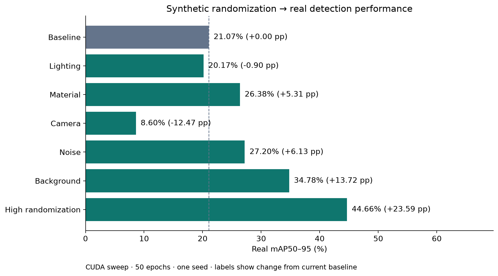
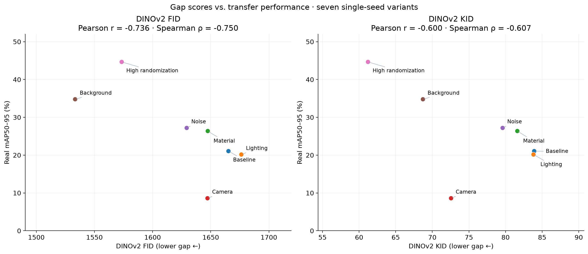
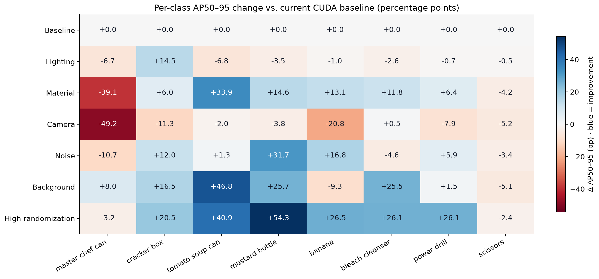

# Synthetic-to-real sweep: findings and limitations

The seven-run sweep supports a bounded finding: **background randomization gives
the largest observed single-axis gain, while the combined high-randomization
configuration performs best overall.** DINOv2 gap scores broadly agree with
transfer performance, but camera randomization is an important failure case.

## Inputs and reproduction

The analysis uses `experiments/gap_scores.json` and its seven SHA-256-matched
result JSONs in `experiments/results/`. All seven runs record YOLOv8n initialized
from `yolov8n.pt`, 50 epochs, batch 8, CUDA, and seed 0. Each variant has 450
synthetic training images and 50 synthetic validation images; detector results
are evaluated on the same 750 real YCB-V test images. Checkpoints are chosen on
synthetic validation, not real-test mAP. DINOv2-small scores compare the 450
training images against those 750 real reference images.

The current baseline is **21.07% mAP50–95** (`baseline.json`). The older CUDA
baseline (16.93%) and Mac baseline are excluded. The reason the earlier CUDA
baseline was replaced is unresolved; this analysis describes the current saved
sweep, not a reconciliation of the training histories.

From the repository root, using the existing environment (Matplotlib and NumPy):

```sh
MPLCONFIGDIR=/tmp/domain-gap-mpl .venv/bin/python -m notebooks.analyze_sweep
MPLCONFIGDIR=/tmp/domain-gap-mpl .venv/bin/python -m unittest notebooks.test_analyze_sweep
```

The script validates result hashes, matching training configs, class coverage,
aggregate/per-class consistency, and recorded correlations before plotting.
It writes PNG/SVG figures and a long-form `per_class.csv` here. It never trains
models or changes source results. There are no error bars: no repeated seeds
were run to estimate training variability.

## 1. Which randomization axes helped?



| Variant | Real mAP50–95 (%) | Change from baseline (pp) |
| --- | ---: | ---: |
| Baseline | 21.07 | 0.00 |
| Lighting | 20.17 | −0.90 |
| Material | 26.38 | +5.31 |
| Camera | 8.60 | −12.47 |
| Noise | 27.20 | +6.13 |
| Background | 34.78 | +13.72 |
| High randomization | 44.66 | +23.59 |

**Observed:** Background is the strongest single-axis variant in this sweep.
Noise and material also improve aggregate mAP; lighting is slightly lower than
baseline, and camera is much lower. The combined configuration beats every
single-axis variant.

**Interpretation limits:** These are effects of the tested configurations, not
universal rankings of randomization techniques. “Material” changes roughness
and specular response, not object texture identity. “Noise” reduces samples
from 64 to 16 and disables denoising, so those two changes cannot be separated.
High randomization also changes objects per scene from 4–6 to 3–8. It is not
simply a clean sum of the five single-axis effects, and this sweep cannot
identify interactions or claim that every added axis helps.

**Hypothesis:** Diverse backgrounds may reduce dependence on the plain synthetic
room, while aggressive camera poses may move the training views away from the
real capture distribution. The camera config widens elevation from 45–50° to
5–89°, radius from 0.95–1.05 m to 0.6–1.2 m, and adds ±45° in-plane rotation.
These mechanisms have not been established by image inspection or matched-pose
experiments. Shared random seeds do not guarantee identical scenes across axes:
the generator consumes random draws in different branches before sampling poses.

## 2. Do gap scores predict transfer?



| DINOv2 metric vs. real mAP50–95 | Pearson r | Spearman ρ |
| --- | ---: | ---: |
| FID | −0.736 | −0.750 |
| KID | −0.600 | −0.607 |

**Observed:** Lower measured gaps generally accompany higher mAP. FID ranks
background as the smallest gap, although high randomization has the best mAP;
KID ranks high randomization best.

**Counterexample:** Camera has lower FID (1647.21 vs. 1665.23) and lower KID
(72.56 vs. 83.91) than baseline, yet mAP drops from 21.07% to 8.60%. Its KID is
also lower than noise, material, and lighting despite worse detection than each.
These scores therefore cannot reliably replace detector evaluation in this sweep.

**Hypothesis:** Whole-image CLS embeddings may emphasize scene appearance over
the object localization and viewpoint coverage needed by a detector. Testing
object crops or spatial features would be a follow-up, not a result of this study.

These are DINOv2-space distances, not standard Inception benchmark scores. FID
has finite-sample bias; unbiased KID estimates can be negative. With only seven
single-seed observations, correlation is exploratory. The real test images are
also the gap reference: this is a retrospective association, not validation on
an independent real dataset. No statistical significance or causal effect is claimed.

## 3. Which objects benefited—and why are scissors weak?



**Observed:** Gains vary sharply by object. Background improves tomato soup can
AP by **46.83 pp**, mustard bottle by **25.74 pp**, and bleach cleanser by
**25.54 pp**, while banana loses **9.26 pp**. Material helps tomato soup can
(+33.94 pp) but harms master chef can (−39.09 pp). Lighting's small aggregate
decline hides a cracker box gain (+14.46 pp). The data does not support a simple
rule that every object benefits from a given axis, or a clean low-texture versus
high-texture grouping.

High randomization improves six of eight classes, led by mustard bottle
(+54.26 pp) and tomato soup can (+40.86 pp). Master chef can (−3.17 pp) and
scissors (−2.40 pp) decline despite the overall gain.

Scissors is the lowest-AP class in **five of seven runs**. Mustard bottle is
lower in baseline (4.80% versus scissors' 5.22%) and lighting (1.34% versus
4.76%). Scissors AP50–95 is **5.22%** at baseline and **2.82%** with high
randomization; all five single-axis variants are below its baseline too.
Broad randomization has not solved this class.

**Why remains unverified.** Thin geometry, occlusion, small visible boxes, or
insufficient useful training examples are plausible causes. The generator drops
instances with fewer than 200 visible pixels, which could disproportionately
remove thin objects, but class-specific retention was not measured here. The
next diagnostic would count retained instances and box sizes by class, then
inspect scissors predictions and misses; the saved AP summaries alone cannot
identify the cause or distinguish localization errors from missed detections.

## Scope of the conclusion

For these eight YCB-V objects, these render settings, and one training seed,
background diversity is the strongest tested individual change and the combined
configuration is best overall. DINOv2 distances provide a useful but imperfect
ordering signal. Independent real-data validation, repeated seeds, render-quality
inspection, and class-level error diagnosis remain necessary before generalizing.
